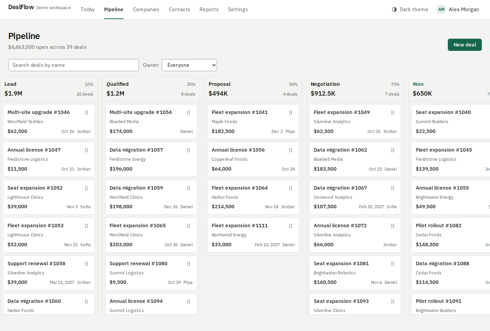
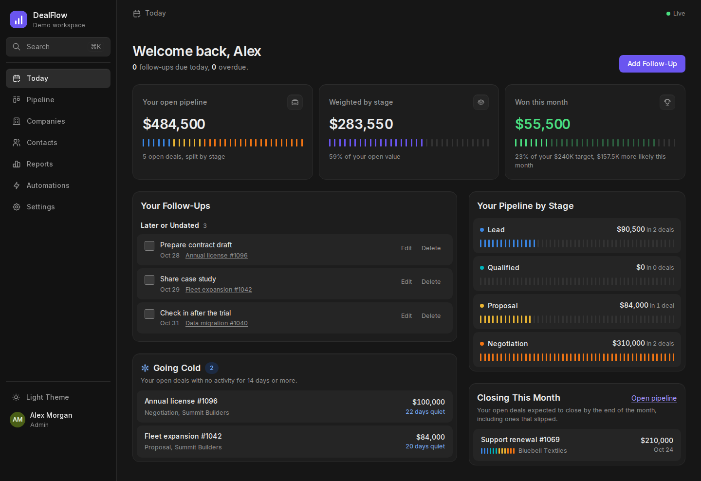
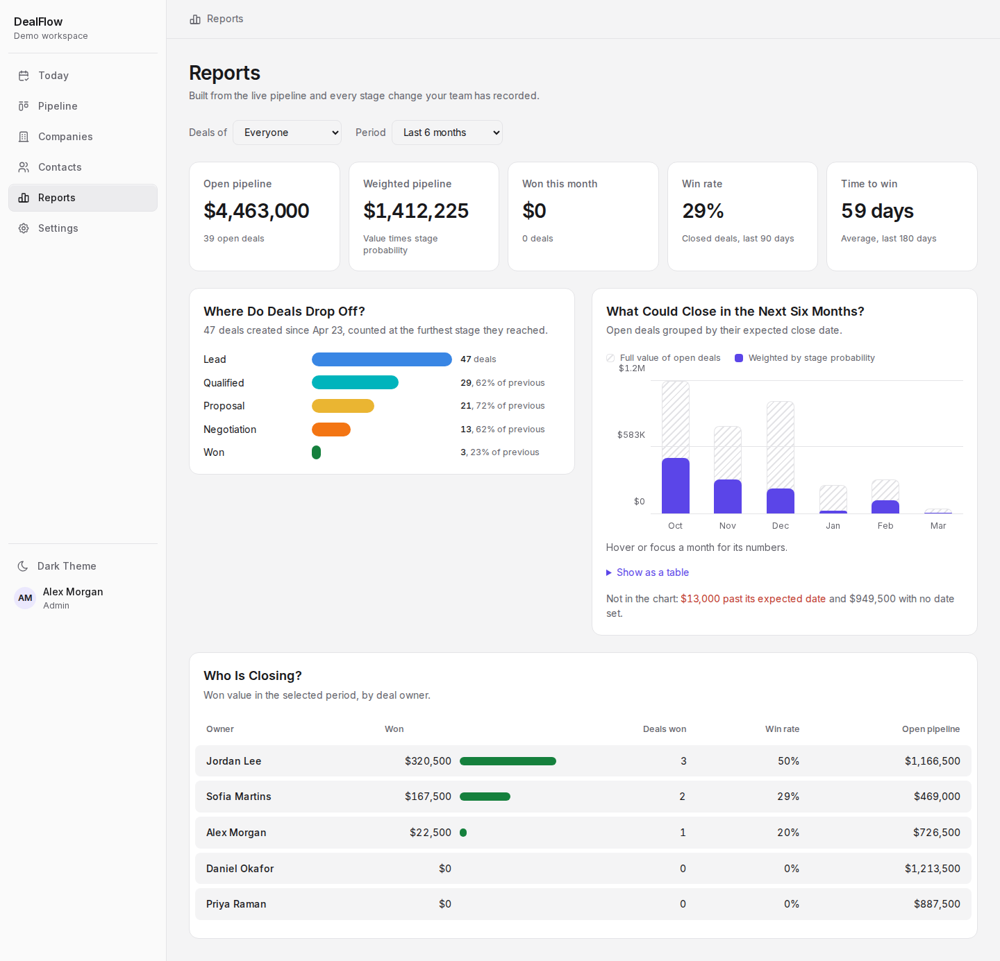
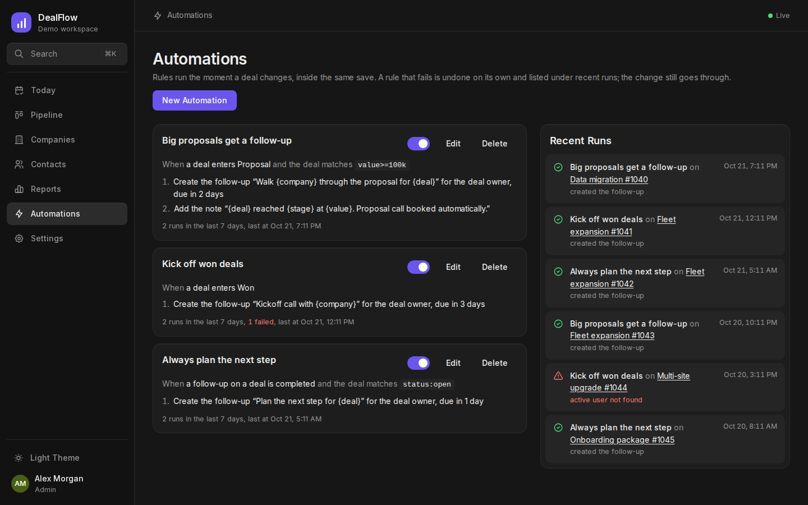
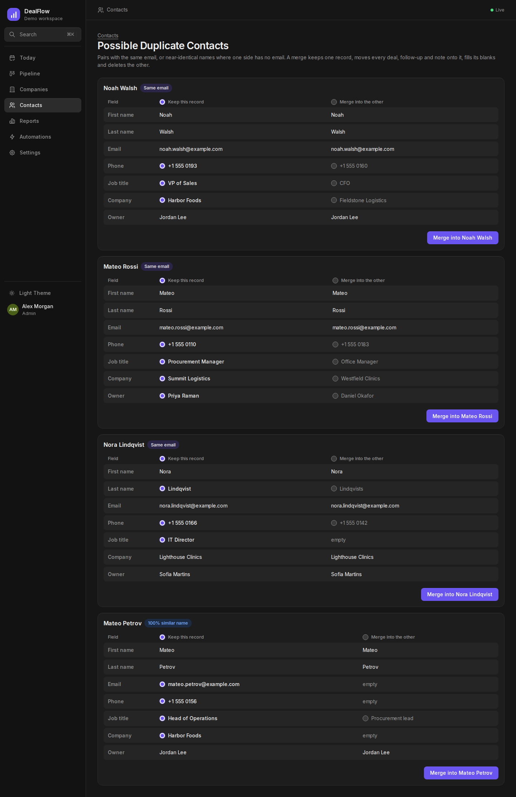
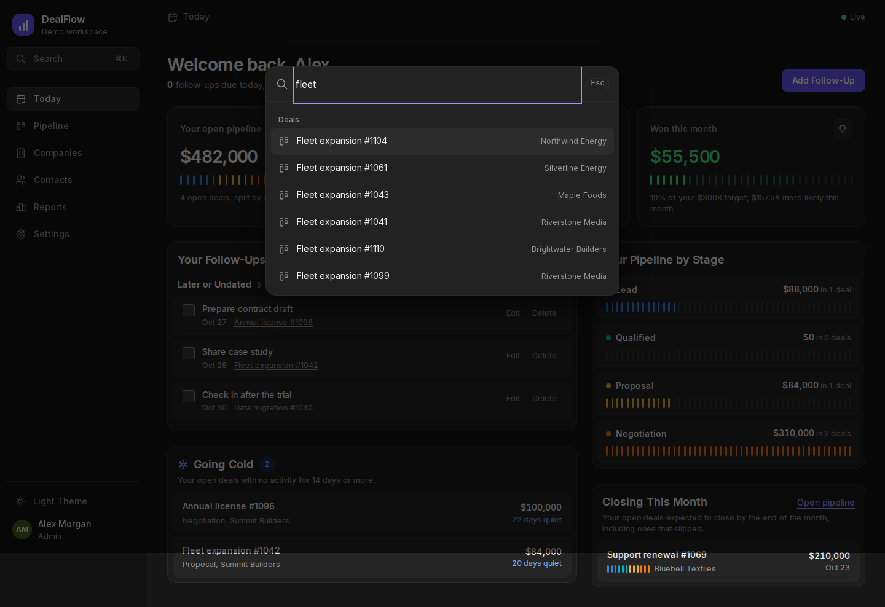
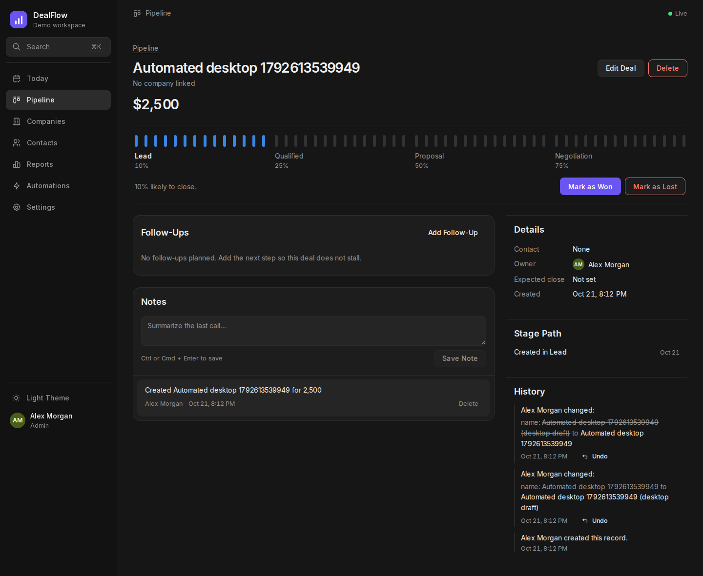
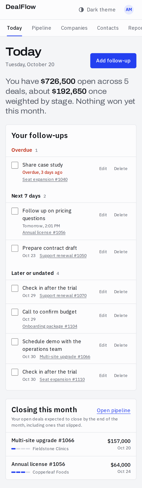

# DealFlow CRM

A multi-tenant sales CRM for small B2B sales teams: a drag-and-drop pipeline that updates
live for the whole team, a filter language for deals, automation rules, a Monte Carlo revenue
forecast, duplicate merging, undo for any edit, Cmd+K search, monthly targets, CSV import and
export, follow-ups, notes, a full change history and sales reports.

The backend is written in Rust (Axum, SQLx, PostgreSQL). The web app is Next.js with
TypeScript.

[](https://github.com/McQueeeeeen/dealflow-crm/actions/workflows/ci.yml)
[](https://github.com/McQueeeeeen/dealflow-crm/actions/workflows/e2e.yml)

**Live demo: https://dealflow-crm-demo.vercel.app**. Use "Fill in the demo account" on the
sign-in page. The demo workspace is reset every night.



## What it does

- **Live for the whole team**: when a teammate moves a deal, adds a note or completes a
  follow-up, every open screen updates within a second, and the header shows who else is
  looking at the same record.
- **Filter language**: `fleet value>=50k -status:lost (owner:me OR stage:prop) closes<30d`
  narrows the board. Mistakes are underlined where the parser found them, and filters can be
  saved as personal or team views.
- **Automations**: "when a deal enters Proposal and matches `value>=100k`, create a follow-up
  for the owner in two days and add a note". Rules run inside the change that triggers them and
  keep a log of what they did or why they failed.
- **What will actually close**: ten thousand simulated futures of the open pipeline, learned
  from how each stage really moved over the last year, give the likely revenue for the month
  and quarter, an 80% range and the chance of reaching the target.
- **Duplicates**: contacts and companies that share an email or domain, or have near-identical
  names, are paired side by side; pick the surviving record and each field, then merge.
- **Undo**: any edit to a deal, contact or company can be undone from its history.
- **Cmd+K**: one box searches deals, companies and people, tolerates typos ("copperleef"
  finds Copperleaf), and runs actions like "New deal" or "Switch theme".
- **Today**: your follow-ups, progress toward this month's target, your pipeline by stage,
  deals closing this month, and deals going cold.
- **Going cold**: an open deal with no notes, completed follow-ups or changes for 14 days
  (adjustable per workspace) gets a snowflake on the board and a nudge on its page.
- **Pipeline**: a kanban board of deals by stage. Drag with a mouse, press and hold on touch
  screens, or focus a deal's handle and press the left or right arrow key.
- **Deals, companies, contacts**: linked records with notes, follow-ups and a readable history
  of every change.
- **Reports**: open and weighted pipeline, a stage-by-stage conversion funnel, a six-month
  forecast by expected close date, monthly targets per rep (managers set them inline), and
  results per salesperson for managers.
- **CSV import and export**: map columns, check the file first (nothing is saved until you
  confirm), then import; existing contacts match by email and companies by domain or name.
  Every list exports to a spreadsheet-safe CSV.
- **Settings**: invite teammates with a role, rename, reorder and re-weight pipeline stages.

| Today | Reports with the revenue simulation, light theme |
|---|---|
|  |  |
| **Automations** | **Duplicate contacts** |
|  |  |
| **Cmd+K search** | **Deal** |
|  |  |



Screenshots are produced by the end-to-end suite against the seeded demo workspace.

## Architecture

```
Browser ──► Next.js (React, TanStack Query)
   ▲          │  /api/auth/*   sets httpOnly session cookies
   │          │  /api/v1/*     same-origin streaming proxy, adds the bearer token
   │          ▼
   └─ SSE ── Rust API (Axum) ──► PostgreSQL 16
                  ▲                    │
                  └── LISTEN ◄─ NOTIFY ┘  (trigger on every audit row)
```

```
backend/
  migrations/        schema, constraints, indexes, append-only audit trigger
  src/api/           one module per resource: handlers, DTOs and SQL side by side
  src/auth/          JWT access tokens, rotating refresh tokens, Argon2id hashing
  src/authz.rs       every role rule in one place
  src/audit.rs       field-level diffs written in the same transaction as the change
  src/live.rs        LISTEN/NOTIFY fan-out to server-sent events, presence
  src/dql.rs         lexer, parser and SQL compiler for the deal filter language
  src/automation.rs  rule triggers, conditions and actions, run in savepoints
  src/simulation.rs  stage model learning and the Monte Carlo forecast
  src/bin/seed.rs    deterministic demo workspace with realistic stage history
  tests/api/         end-to-end tests against a real database
frontend/
  src/app/           routes: today, pipeline, deals, companies, contacts, reports, settings
  src/app/api/       session endpoints and the API proxy
  src/components/    UI primitives, forms, the pipeline board, charts
```

## Engineering decisions

**Tenant isolation is enforced by the database, not only by handlers.** Every table carries
`organization_id`, and every reference between tables is a composite foreign key on
`(organization_id, id)`. A deal cannot point at another workspace's company, stage or user
even if a handler forgot a check; the insert fails and the API answers with a field error.
Every query is also scoped by the caller's organization, so another workspace's IDs behave
exactly like IDs that do not exist (404, not 403).

**Concurrent edits do not overwrite each other.** Deals carry a `version`. Updates and stage
moves lock the row, compare versions and return `409 Conflict` if someone else saved first.
The UI tells the person what happened and reloads the current state.

**A stolen refresh token is caught on reuse.** Access tokens live for 15 minutes. Refresh
tokens are random, stored only as SHA-256 hashes, and rotate on every use. Presenting a spent
refresh token outside a 10-second grace window (two tabs refreshing at once) is treated as
theft and revokes the whole session family. Deactivating a user revokes their sessions, and
role changes apply to the very next request because the role is read from the database, not
from the token.

**Tokens never reach browser JavaScript.** The Next.js server keeps them in httpOnly cookies
and forwards API calls with the bearer token attached. The browser only talks to its own
origin, so there is no CORS surface.

**The audit log is append-only.** Changes are recorded as field-level diffs inside the same
transaction as the change, and a database trigger rejects any `UPDATE` on audit rows.

**Reports come from history, not snapshots.** Every stage move is stored. The funnel counts a
deal as having passed a stage if it ever reached that stage or a later one, so skipping a
column on the board does not distort conversion. Money is stored as integer minor units in a
single workspace currency, so sums are exact.

**Live updates ride on the audit log.** Every change already writes an audit row inside its
transaction, so a trigger on that table calls `pg_notify`. PostgreSQL delivers the
notification only if the transaction commits, which means a browser never hears about a
change that rolled back. Each API instance holds one `LISTEN` connection and fans
notifications out to server-sent event streams, filtered to the caller's workspace. Browsers
batch the events and refetch only the affected queries; a stream that falls behind gets a
single "resync" instead of a flood. Streams close after ten minutes so the access token is
re-checked, and the client reconnects with backoff.

**The filter language compiles to SQL, never into it.** A hand-written lexer and recursive
descent parser turn the filter into a typed tree: `OR` binds looser than the implicit `AND`,
`-` and `NOT` negate, parentheses group, and each field parses its own values (`50k`, `1.2m`,
`30d`, `2w`, `2026-12-31`). Errors carry character spans, which the UI underlines. The compiler
emits SQL with a placeholder for every value and wraps each condition in `coalesce(…, false)` so
negation behaves on empty fields. The same language serves the board, saved views and
automation conditions.

**Automations run inside the change, each in its own savepoint.** Moving a deal fires the
rules for that stage in the same transaction, so their follow-ups and notes commit or roll back
with the move. Each rule gets a savepoint: if one fails, for example because its new owner was
deactivated, only that rule is rolled back, the failure is logged, and the move and the other
rules go through. Triggers and actions are tagged enums stored as JSONB, and rules are matched
by JSONB equality on the trigger.

**The forecast learns from history and says how sure it is.** For each open stage the API counts
how often deals moved forward and how long they stayed, shrinking thin evidence toward the
stage's configured probability (a beta prior worth five observations). Each open deal is then
played forward ten thousand times, conditioning its first stay on the time already spent in its
stage. Revenue already won is added to every run, and the result is reported as percentiles,
a histogram and the share of runs that reach the target. The run is seeded, so the same
pipeline gives the same answer.

**An undo checks before it writes.** The audit row already holds the before and after of every
field. An undo writes the old values back through `jsonb_populate_record`, but only if the
fields still hold the values that change set; otherwise it answers 409 and asks to undo the
later change first. The undo is an edit like any other, so it can be undone too.

**Duplicates are found and merged by one generic implementation.** Contacts and companies are
described by their table, name expression, matching key, mergeable fields and the tables that
reference them. Records with different emails or domains are never paired on name alone. A
merge moves every reference, fills the kept record's blanks and records both sides in the
audit log, in one transaction.

**Search is one trigram query per kind.** Deals, companies and contacts are matched with
`ILIKE` for exact substrings and `pg_trgm` word similarity for typos, both served by the same
GIN indexes, inside a transaction that sets the similarity threshold locally.

**Imports preview by rolling back.** A dry run executes the real import, every validation,
dedupe and insert, inside a transaction and then rolls it back. The preview cannot disagree
with what the import will do, because it is the import. Exported cells that start with `=`,
`+`, `-` or `@` are prefixed so a spreadsheet will not run them as formulas.

**Errors have one shape.** Every failure is `{"error": {"code", "message", "fields"}}`.
Constraint violations are mapped to field-level validation errors by constraint name.

## Deployment

One Vercel project runs two services (see `vercel.json`): the Next.js app is public, and the
Rust API is a private container that only the web service can reach, through a service binding
that sets `API_URL`. PostgreSQL is Neon from the Vercel Marketplace. A scheduled workflow
re-seeds the demo workspace every night.

## Running it

Everything in containers:

```bash
docker compose up --build
docker compose run --rm seed
```

Open http://localhost:3000 and sign in as `demo@dealflow.dev` with the password
`dealflow-demo`. These credentials only exist in the seeded demo workspace.

Without Docker you need Rust (stable), Node.js 22 and PostgreSQL 16:

```bash
cd backend
export DATABASE_URL=postgres://localhost/dealflow JWT_SECRET=$(openssl rand -hex 32)
cargo run --bin seed      # migrates and loads demo data
cargo run                 # API on :8080

cd ../frontend
cp .env.example .env.local
npm install && npm run dev   # web app on :3000
```

## Tests

```bash
cd backend && cargo test
```

Unit tests cover password hashing, token signing, validation, pagination, audit diffs and the
role rules. The integration suite starts a fresh, migrated PostgreSQL database for each test
and drives the real router: registration and login, refresh-token rotation and reuse
detection, deactivation, tenant isolation, cross-tenant references, role permissions,
optimistic concurrency, stage moves, the audit trail and its immutability, search and
pagination, tasks, notes, pipeline reordering, the numbers behind every report, live events
that never cross workspaces, presence, typo-tolerant search, targets, CSV dry runs and
dedupe, formula-safe export, last-activity tracking, the filter language end to end (including
an injection attempt), saved views, automations firing on every trigger, savepoint isolation of
a failing rule, the simulation's percentiles and target odds, duplicate pairing and merging, and
undo with its conflict check. Unit tests cover the parser's precedence, values and error spans,
the SQL it emits, the forecast's learning, sampling and summaries.

The end-to-end suite boots the whole stack in CI (PostgreSQL, the API with demo data, the
production Next.js build) and drives it with Playwright on desktop and phone viewports. It
visits every screen in both themes and fails on any console error, any sideways scrolling on
a phone, or any serious WCAG 2.1 AA violation reported by axe. It also moves a deal across the
board with the arrow keys, completes a follow-up, adds a note, checks form validation, the theme
toggle and signing out, finds a company through Cmd+K with a typo, watches a deal created by
another user appear on the open board, imports a CSV through its preview, downloads an
export, filters the board and saves a view, reads the simulation, builds an automation and
watches it run, merges two duplicate contacts and undoes an edit.

CI runs `rustfmt`, `clippy -D warnings`, the full test suite and the seed script for the
backend, and Prettier, ESLint, a production build and `tsc` for the frontend.

## Design

The visual direction, palette with contrast reasoning, type scale and motion rules are in
[DESIGN.md](DESIGN.md). Both themes meet WCAG AA contrast, every control is reachable by
keyboard, including moving deals across the board.
